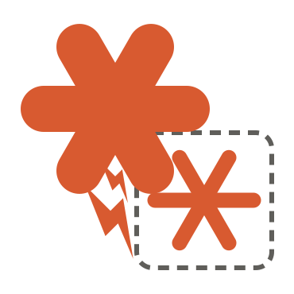

# Running Claude in Podman containers



The main Claude used in VSCode or your terminal still runs like normal.  However, now we have it in `acceptEdits` mode (edit files in the active repo freely, ask before running any command) -- no `--dangerously-skip-permissions` or `auto` modes for it.

To run other commands to get tasks accomplished, it will spawn a long-lived lightweight container
( [Containerfile](Containerfile) )
per repo, that it can talk to.  This container's Claude is in `auto` mode, and has a generous amount of packages installed that it often uses to get work done.

This avoids the "prompt fatigue" of continuously being asked "can I run this?" (you: interrupted again, scans request, yah yah fine) ... in a loop. 😎


## What you get

- **One container per repo**, started on demand, named after the repo dir (`claude-petabox`, `claude-petabox2`, ...).
  Stop or remove them anytime -- they respawn when next needed, including after a reboot.
- **Scoped filesystem access:** the repo you're working in is r/w (except `.git`, `.claude`, `.vscode`: r/o);
  every dir in `$CLAUDE_PODS` is r/o, so Claude can look around your other cloned repos;
  `~/.ssh`, `~/.claude` and other credentials are **not** visible.
- **https-only outbound network** by default. Plain `http://`, ssh, odd ports: refused immediately.
- **Dev servers at their usual ports** -- hugo in a pod is just `http://localhost:1313` on your Mac.
- **Optionally, Claude itself inside the container**, with its own separate login/config.
- macOS (via a podman machine) and Linux.

How does this compare to Docker Sandboxes?  See [claude-pod or Docker Sandboxes?](or-docker-sandboxes.md)

```
claude-pod exec 'cmd ...'     run cmd (zsh -c) inside this repo's container
claude-pod up                 start the container if needed (exec does this anyway)
claude-pod down               stop + remove it (servers, downloads, installs gone)
claude-pod ports              which pod each localhost port points at
claude-pod claim [port...]    point localhost:port at THIS repo's pod
claude-pod --build            (re)build the image, e.g. to update claude
claude-pod [claude args...]   run Claude inside this repo's container
```

## Overview


## Setup

We're using `podman` instead of docker -- MacOS: `brew install podman`.

List the dirs to share as a space-separated `CLAUDE_PODS` env var
(e.g. in your `~/.zshrc` or `~/.bashrc`).
One or more dir of cloned dirs is fine.
The author gives it generous r/o access to most of the repos that she uses and has cloned
(just keep in mind that claude container pods can read anything you set in `CLAUDE_PODS`).
```sh
export CLAUDE_PODS="$HOME/dev $HOME/repo"
```
Repos you want to work on need to live under one of these dirs too -- a repo anywhere else can't get a pod,
since (on a Mac) the podman VM can't see it.


### MacOS: podman machine

A Mac needs a linux VM in order to run "containers" -- the "podman machine".
The volume mounts below (CLI args `-v ..`) get setup to be the _maximum_ that an actual later running podman container can "see".

On Linux, containers run on the host kernel -- there is no VM,
so skip this whole step. Your filesystem is already visible to podman and
`CLAUDE_PODS` is all you need to set. The `claude-pod` script itself is the same on both.

You only have to run this once.  The snippet below works in both `bash` and `zsh`.

```sh
# NOTE: this removes any prior default podman machine first.

VOLS=()
for d in $(echo ${CLAUDE_PODS?}); do VOLS+=(-v "$d:$d"); done

mkdir -p ~/.claude-pod
podman machine stop
podman machine rm podman-machine-default
podman machine init --cpus 5 --memory 4096 \
  -v $HOME/.claude-pod:$HOME/.claude-pod \
  -v /private:/private \
  -v /var/folders:/var/folders \
  "${VOLS[@]}"
podman machine start
```
After each reboot, you'll need to rerun `podman machine start`.


### Install

Clone this repo somewhere locally.  The example below cloned into `$HOME/work/`.

Put `claude-pod` on your `PATH`, eg:
```sh
ln -s $HOME/work/claude-pod/claude-pod /usr/local/bin/
```
The first `claude-pod` command builds the image (a minute or two, once).

Allow your main Claude to run these commands by adding them to your `$HOME/.claude/settings.json`:
(You will need to restart VSCode if you are using Claude that way after making these changes)

```json
{
  "permissions": {
    "defaultMode": "acceptEdits",
    "allow": [
      "Bash(claude-pod exec *)",
      "Bash(claude-pod up)",
      "Bash(claude-pod ports)",
      "Bash(claude-pod claim *)"
    ]
  }
}
```
`acceptEdits` lets your main Claude edit files in the repo without asking; anything else it wants to run goes to the container.
(`defaultMode` is optional: leave it out to be asked about edits too.
Or put it in a repo's `.claude/settings.json` instead, to use `acceptEdits` only there.)

Claude Code matches these rules against the literal command text and doesn't expand `$HOME`/`$USER`/`~` in them,
so a bare `claude-pod` on your `PATH` is what keeps them the same for everyone.

---

Finally, tell your main Claude to use it, by adding this to your `$HOME/.claude/CLAUDE.md`
(its instructions for every project):

````md
## Run commands in claude-pod, not on the host
Anything beyond reading/editing files (running scripts, tests, linters, builds, `python`/`node`/`deno`,
servers like `caddy`/`hugo`, package installs, downloads, `curl`, etc.) goes into the repo's container:

```sh
claude-pod exec 'cmd ...'   # zsh -c inside this repo's container (auto-starts it)
claude-pod ports            # where each http://localhost:PORT points
claude-pod claim [port...]  # point localhost:PORT at this repo's pod (steals)
```
Always type the bare `claude-pod` (it's on `PATH`): the permission rules match the literal command text.

- Run it from (a dir inside) the repo you're working in -- one long-lived container per repo.
- Inside: the current repo is **r/w** (except `.git`, `.claude`, `.vscode`: r/o).
  Every dir in `$CLAUDE_PODS` is mounted **r/o** -- look around in them freely for context.
  Install whatever extra packages you need.
- Network is **https (443) only**; plain `http://`, ssh, etc. are refused.
- Servers: bind `0.0.0.0` on their usual port P, started detached (eg: `setsid nohup ... &`).
  The host sees them at `http://localhost:P` (P<1024: P+10000).
- `~/.ssh`, `~/.claude`, and other credentials are **not** visible in the container -- don't push/auth from there.
````

---

Once you are setup, Claude will automatically start containers if/as needed.

You can then give your main Claude (_just_) "edit" privs (r/w files) to the repo you're working in -- and everything else it might want to do can run in a long-running, restartable container that it takes care of running, for whatever arbitrary commands it might want to run.  So if it wants to:
- install extra packages beyond what's in [Containerfile](Containerfile)
- create and run arbitrary python commands to run or check things
- fire up a `caddy` webserver
- lint check with `deno` or `node`
- or just about anything else

-- it can send all that to the podman container and collect the results, writing to your repo if needed.


## Try it out!

Make a new repo under one of your `$CLAUDE_PODS` dirs, open Claude there, and ask something like:

> Make me a simple one-page website that shows a random fun fact each time I click a button,
> and serve it with `caddy` so I can see it in my browser.

The first time, Claude's `claude-pod exec` builds the image (a minute or two), starts this repo's pod,
and runs caddy in it.  Its port gets claimed for this pod, so you can open eg: http://localhost:8080 on your Mac.
`claude-pod ports` shows where each port points.

Tip: if caddy ends up on its default port 80, look at http://localhost:10080 instead.


## Details

### Mounts
There is one container per repo you work on.  Any files or dirs in your `$CLAUDE_PODS` var are mounted _readonly_ inside each container, with the repo you're working on mounted `read/write`.
Everything is mounted at its real path, so absolute paths line up with the host.

So if you have multiple related repos, Claude can look around (readonly) into your other repos in `$CLAUDE_PODS` for information it might need to complete a task.

The repo's `.git`, `.claude` and `.vscode` dirs stay _readonly_, since host-side git/claude/vscode *execute* what those contain.
`CLAUDE_POD_GIT_RW=1 claude-pod up` makes `.git` writable (the container gets recreated).

No `$HOME/.ssh` or main `$HOME/.claude` or other credentials can be "seen" in your containers.

Each pod is labelled with its repo's full path, so a same-named dir somewhere else is refused,
rather than handed the other clone's pod (and its r/w mount).  Rename one of the dirs, eg: `petabox2/`.


### Ports: one proxy, same port numbers
Servers inside a pod use their normal ports (hugo on 1313, vite on 5173, ...), bound to `0.0.0.0`.
Repo pods publish nothing themselves, so they always start, however many are running.

Instead, every pod joins the `claude-pod` podman network, and one small `claude-pod-proxy` container
publishes the usual ports on the Mac **at the same number** (`localhost:1313`), forwarding each port to
whichever pod has claimed it -- like an ingress/LB in front of them.

- After each `claude-pod exec`, any port that pod listens on is claimed automatically **if it's free**:
  unclaimed, or the pod that held it isn't listening there anymore.
- `claude-pod claim [port...]` takes ports even from a pod that *is* still listening.
  That pod's server keeps running; it just stops receiving the traffic. With no ports given, it claims every port the pod is listening on.
- `claude-pod ports` shows where each `localhost` port currently points.
- macOS won't let podman bind ports below 1024 to `127.0.0.1`, so 80 and 443 show up as `localhost:10080` and `localhost:10443`.
  A port already in use on the Mac when the proxy starts (eg: 5000, which AirPlay Receiver uses) is skipped.
- Claims are stored in `claude-pod.routes` next to the script and restored when the proxy restarts.
  To publish more ports, edit `CPORTS` in the script; the proxy is recreated on its next use.


### Network: https only, by default
We *did* elect to give the containers open internet access to `https://` hosts.  YMMV.

Outbound traffic from each container is limited to **TCP/UDP 443** (https, including HTTP/3). Everything else (plain `http://` on port 80, ssh, odd ports, DNS to any server but the container's own) is **rejected immediately** with "connection refused", not left to time out.

Still allowed:
- **DNS**, but only via podman's own forwarders (from the container's `/etc/resolv.conf`), which hand lookups to your Mac's resolver. So on a work VPN, containers see the VPN's DNS too.
- **Replies on connections made *into* the container**, so published ports (`claude-pod ports`) work.
- **Loopback** inside the container (e.g. a `caddy` on `:80` testing itself).
- **ICMP**, so IPv6 keeps working.

The rules are `nftables`, installed by container-root at every start through a one-off privileged `exec`. The container itself gets no extra capabilities, and runs with `no-new-privileges`, so the uid Claude runs as can't list or remove them.

The filter limits *ports*, not *destinations*. With a VPN up, container traffic goes through your Mac's routes, so internal `https` services on the VPN are reachable.

To turn the filter off for a repo's container (it gets recreated):
```sh
CLAUDE_POD_NET=open claude-pod up
```


### Optional: running Claude directly in containers
You can enter a container and additionally auth Claude (once, for all your repos) to run on CLI/terminal inside that container via:
```sh
# `cd` to a cloned repo you are working in, then
# (`claude-pod` is on your `PATH` from the `ln -s` step above)
claude-pod
```
The auth will get setup into your separate `$HOME/.claude-pod/` dir.
Your `$HOME/.claude/` and `$HOME/.claude-pod/` remain separate, so privs/allowances stay different for each.

Claude in the container runs in `auto` permission mode; pick another with eg: `CLAUDE_POD_MODE=acceptEdits claude-pod`
(`bypassPermissions` = no prompts at all).


### Updating
Claude's self-updater can't work inside the container, so update by rebuilding the image:
```sh
claude-pod --build
```
Each pod notices the new image and recreates itself on its next use.
If you reboot your machine, the containers go away, but they'll just respawn later on demand.


## Pro Tips
### reclaim space from removed files
pod containers can grow over time as you work. the macos podman machine can start taking up more space of its "sparse bundle" over time.  trim back used-on-disk space esp. relating to used-then-deleted files with:
```sh
podman machine ssh sudo fstrim -av
```


### flash external storage
Consider placing all of your **podman** images & containers **on a flash drive!**
The author got a $80 USB-C 256GB flash drive, transfers up to 400MB/s, by
[Samsung](https://www.amazon.com/dp/B09WB2NL8W)
You then just set
```sh
export XDG_DATA_HOME=/Volumes/flash/podman
```
in your `.bashrc/.zshrc` (etc.)
Then your claude can go nuts in each container, installing apps, thrashing file system, pulling down stuff -- and you can not care, avoid stuff "leaking" into your system / Time Machine backups, etc.

### reset everything at once
Want to update, replace, or wipe *everything* (ALL podman containers and images) all at once?
```sh
podman rm -v --all
podman rmi --all
```

### misc
[Lightning talk, 5 minutes, Oct 2026](lightning-talk/)


## Future?
Consider blocking, via DNS names:
- docs.google.com
- drive.google.com
- googleusercontent.com
