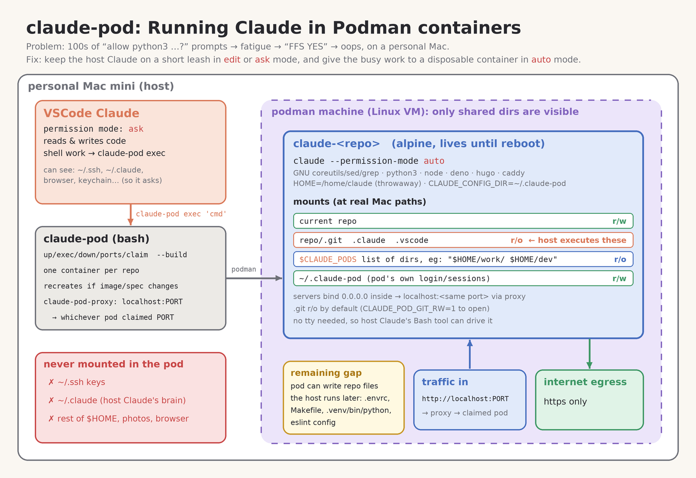

# claude-pod - Running Claude in Podman containers
2026-10-19 lightning talk

**https://github.com/traceypooh/claude-pod**


## 1. The problem: prompt fatigue
- Claude: _"can I run this?"_ … you: _interrupted again, scan it, yah yah fine_ … repeat 🔁
- Options were: babysit it, `auto`, or <br> `--dangerously-skip-permissions` 😬

```
[It's a 5 min short talk, so to avoid any delays, gets demo started]
[Tracey has removed all pods before demo to show the automatic setup]
[Tracey then, using VSCode in a random repo, asks the Claude plugin in the side-panel]
"can you make a video 30s w thumbs and a player and web page?"
```


## 2. The split
- **Main Claude** (VSCode / terminal): `acceptEdits` → edits files in the repo, nothing else
- **Everything else** → `claude-pod exec '...'` → a long-lived podman container, **one per repo**
- No prompts for those, and nothing runs on your Mac


## 3. What the pod can (and can't) touch
- current repo: **r/w** (except `.git` `.claude` `.vscode`: r/o, since host tools _execute_ those)
- your other cloned repos (`$CLAUDE_PODS`): **r/o** so Claude can look around
- `~/.ssh`, `~/.claude`, credentials: **not visible**
- network: **https (443) only**; `http://`, ssh, etc. refused right away


## 4. Ports keep their usual numbers
- servers in a pod are just `http://localhost:8080` (hugo `:1313`, vite `:5173`, …)
- one small proxy container forwards each port to whichever pod claimed it
- `claude-pod ports` shows where each one points


## 5. Setup: 3 steps
1. `brew install podman` + a one-time `podman machine init`
2. `export CLAUDE_PODS="$HOME/dev $HOME/repo"`
3. allow `claude-pod exec *` in `~/.claude/settings.json` + a paragraph in `~/.claude/CLAUDE.md`

Pods start on demand, and respawn after a reboot.


## 6. Show the demo results
```
[tracey opens http://localhost:8888]
```
which showed this [demo page](https://traceypooh.github.io/claude-pod/lightning-talk/demo-page)



